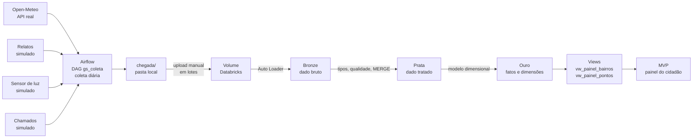

# Luz Segura | Big Data Architecture & Data Integration

Global Solution | 4ESPY

Pipeline de dados do **Luz Segura**, o componente **Dados** do MVP: coleta orquestrada no Airflow, ingestão incremental no Databricks (Bronze, Prata e Ouro), regras de qualidade, modelo dimensional e proteção de dados pessoais (LGPD).

## Integrantes
- Fabrício Gutierrez Saavedra - RM97631
- Márcio Gastaldi - RM98811
- Arthur Bessa Pian - RM99215
- Davi Desenzi - RM550849
- João Victor - RM551410

## O produto em uma frase

O Luz Segura ajuda a identificar **onde a iluminação pública está falhando**, cruzando relatos de cidadãos, medições de luminosidade e o andamento dos chamados de manutenção, para priorizar os bairros e pontos que mais precisam de conserto.

**Cidadão e território:** pessoas que dependem de transporte público e andam a pé ao anoitecer ou de madrugada (trabalhadores de turno, estudantes noturnos e idosos), em bairros de Osasco (SP).

## Perguntas que o MVP responde

1. Quais pontos e bairros estão mais escuros agora?
2. O relato enviado pelo cidadão bate com a medição do sensor?
3. Em que horários e condições de tempo a iluminação piora?
4. Quantos chamados de manutenção já foram resolvidos e quanto tempo os pendentes esperam?

## Arquitetura e fluxo de dados



O Databricks Free Edition não se conecta ao Airflow. Por isso os arquivos gerados em `chegada/` são enviados ao Volume pela interface do Databricks, em lotes.

## Fontes de dados

| Fonte | Tipo | Formato | Frequência | Observação |
|---|---|---|---|---|
| Clima (Open-Meteo, API `archive`) | **Real**, externa | JSON | Diária | `cloud_cover` e `precipitation` por hora, nas coordenadas de Osasco. Não exige chave |
| Relatos de iluminação | **Simulada** | CSV | Diária | Relatos de cidadãos por ponto, com nome e contato **fictícios** |
| Leituras do sensor de luminosidade | **Simulada** | CSV | Diária | Valor bruto do conversor analógico (ADC, 0 a 4095), 1 leitura por hora e por ponto |
| Chamados de manutenção | **Simulada** | CSV | Diária | Foto diária dos chamados, com datas de abertura e de conserto |
| Cadastro de pontos | Referência estática | CSV | Única | Endereço, bairro e tipo de cada ponto (**fictícios**) |

A justificativa e as premissas da simulação estão em [`docs/simulacao.md`](docs/simulacao.md).

## Estrutura do repositório

```
├── README.md
├── docker-compose.yaml        # Airflow (quick-start oficial) com a pasta chegada/ montada
├── dags/
│   ├── gs_coleta.py           # DAG principal
│   └── geradores/
│       ├── __init__.py
│       └── simulacao.py       # geradores de sensor, relatos e chamados
├── referencia/
│   └── cadastro_pontos.csv
├── databricks/
│   ├── 01_bronze.py           # Auto Loader
│   ├── 02_prata.py            # tipos, qualidade e MERGE
│   ├── 03_ouro.py             # dimensões, fatos e views
│   └── 04_consultas.sql       # as 5 consultas
├── amostras/                  # um pouco de cada fonte
├── docs/
│   └── simulacao.md
└── prints/                    # evidências do relatório
```

A pasta `chegada/` (saída do DAG) e o arquivo `.env` ficam fora do Git.

## Como reproduzir

### Pré-requisitos
- Docker Desktop (com pelo menos 4 GB de memória para o Docker; o ideal é 8 GB)
- Conta no Databricks Free Edition
- Git

### 1. Airflow
1. Baixe o `docker-compose.yaml` da documentação oficial do Airflow (página "Running Airflow in Docker"). Este projeto usou a versão 3.1.2.
2. No `docker-compose.yaml`, adicione o volume da pasta de chegada junto aos demais:
   ```yaml
   - ${AIRFLOW_PROJ_DIR:-.}/chegada:/opt/airflow/chegada
   ```
3. Crie as pastas `dags`, `logs`, `plugins`, `config` e `chegada`, e o arquivo `.env` com `AIRFLOW_UID=50000`.
4. Inicialize e suba:
   ```bash
   docker compose up airflow-init
   docker compose up
   ```
5. Acesse `http://localhost:8080`. O usuário e a senha padrão do quick-start são `airflow` e `airflow` e servem **apenas para uso local**.
6. Ative o DAG `gs_coleta`. Com `catchup=True` e início em 03/11/2026, ele gera um arquivo por fonte e por dia em `chegada/`.

**Estrutura do DAG:** `inicio` seguido de 4 tarefas **em paralelo** (`coletar_clima`, `gerar_sensor`, `gerar_relatos`, `gerar_chamados`) e, por fim, `conferir_chegada`, que falha se algum arquivo esperado do dia não existir.

### 2. Databricks
1. Crie o schema e o volume:
   ```sql
   CREATE SCHEMA IF NOT EXISTS workspace.gs;
   CREATE VOLUME IF NOT EXISTS workspace.gs.chegada;
   ```
2. No Volume `/Volumes/workspace/gs/chegada`, crie as pastas `clima`, `sensor`, `relatos`, `chamados` e `referencia`.
3. Suba `referencia/cadastro_pontos.csv` para `referencia/` e os arquivos de `chegada/` para as pastas correspondentes, **em lotes** (ver "Lotes de ingestão").
4. Execute os notebooks na ordem: `01_bronze.py`, `02_prata.py`, `03_ouro.py`. Depois, as consultas de `04_consultas.sql`.

## Camadas

### Bronze (dado bruto)
Carga incremental com **Auto Loader** (`cloudFiles`, `availableNow`), com checkpoint. Só os arquivos novos entram, e rodar de novo não duplica. Cada linha guarda `arquivo_origem` e `carregado_em`.

Tabelas: `bronze_clima`, `bronze_sensor`, `bronze_relatos`, `bronze_chamados`.

### Prata (dado tratado)
Tipos corretos, nulos e inválidos tratados e `MERGE` pela chave. Cada tabela tem **3 regras de qualidade**, e o total barrado por cada uma é exibido em uma tabela de contagem.

| Tabela | Chave do MERGE | Regras de qualidade |
|---|---|---|
| `prata_clima` | cidade + data_hora | nebulosidade fora de 0 a 100; chuva negativa; valor nulo |
| `prata_sensor` | id_leitura | leitura nula; leitura fora de 0 a 4095; ponto inexistente |
| `prata_relatos` | id_relato | classe inválida; ponto inexistente; duplicado (mesmo ponto, contato e classe em menos de 15 min) |
| `prata_chamados` | id_chamado | id nulo; ponto inexistente; conserto antes da abertura |
| `prata_pontos` | (carga única) | cadastro de referência |

O clima chega como listas paralelas dentro de um JSON; na Prata ele é convertido com `from_json` e expandido com `arrays_zip` e `explode` (24 linhas por dia). Dos chamados, é mantida a foto mais recente de cada `id_chamado`.

### Ouro (modelo dimensional)

| Tabela | Tipo | Conteúdo |
|---|---|---|
| `fato_ocorrencia` | Fato | Um registro por relato ou medição (`tipo_evento`), com classe, lux estimado e `relator_hash` |
| `fato_chamado` | Fato | Um registro por chamado, com status, dias para conserto e dias pendente |
| `dim_local` | Dimensão | Ponto, endereço, bairro, tipo e município |
| `dim_tempo` | Dimensão | Data, hora, faixa horária e dia da semana |
| `dim_clima` | Dimensão | Nebulosidade, chuva e condição de chuva |

## Consultas SQL (`databricks/04_consultas.sql`)

| # | Pergunta | Tipo |
|---|---|---|
| 1 | Quais pontos (com endereço) são mais escuros? | Operacional |
| 2 | Resumo por bairro: pontos críticos, lux médio e pior ponto | Gestão |
| 3 | Relatos "escuro" por bairro e faixa horária | Padrão temporal |
| 4 | Efeito do clima (com chuva e sem chuva) nos relatos | Cruzamento com fonte real |
| 5 | Resolução de chamados por bairro e pendência máxima | **Impacto** |

As interpretações dos resultados estão no relatório em PDF.

## LGPD e proteção de dados

- **Minimização:** `relator_nome` e `relator_contato` **não passam para a Ouro**. Entra apenas `relator_hash`, calculado com `sha2(relator_contato, 256)`.
- **Dados fictícios:** todos os nomes, contatos, bairros e endereços do repositório são inventados. Não há dado pessoal real.
- **Sem credenciais no código:** o Open-Meteo não exige chave, e nenhuma senha ou token é versionado. `.env` e `chegada/` estão no `.gitignore`.
- **MVP:** exibe apenas dados agregados por bairro e por ponto, sem identificar relatores.

## Dados simulados: resumo

- Relatos, sensor e chamados são **simulados** e identificados pela coluna `origem = 'simulado'`.
- A geração usa **semente fixa por dia**, então rodar de novo produz os mesmos arquivos.
- Os arquivos trazem **defeitos injetados de propósito** (leitura nula, leitura fora da faixa, relato duplicado, classe inválida, ponto inexistente) para que as regras de qualidade da Prata tenham o que barrar.
- **Premissas:** `lux_estimado = valor_adc × 0,008` (fator fictício); limiares de classificação: abaixo de 1,5 lux é "escuro" e abaixo de 5 lux é "fraco"; ponto crítico é lux médio abaixo de 1,5 com ao menos um relato "escuro".
- Os relatos são sorteados **sem relação com o clima** e a concordância entre relato e sensor existe por construção. Os resultados das consultas 2 e 4 demonstram o funcionamento do pipeline, não são descobertas sobre o mundo real.

Detalhes em [`docs/simulacao.md`](docs/simulacao.md).

## Lotes de ingestão (requisito 05)

| Momento | clima | sensor | relatos | chamados |
|---|---|---|---|---|
| Lote 1 (arquivos de 03 a 09/11) | [PREENCHER] | [PREENCHER] | [PREENCHER] | [PREENCHER] |
| Lote 2 (arquivos de 10 a 14/11) | 12 | 432 | 108 | 36 |
| Reexecução, sem arquivo novo | [PREENCHER] | [PREENCHER] | [PREENCHER] | [PREENCHER] |

Os prints correspondentes estão em `prints/`.

## Integração com o MVP

O MVP consome duas views da camada Ouro, exportadas como snapshot (`vw_painel_bairros` e `vw_painel_pontos`), e exibe o ranking de bairros e os pontos de cada bairro. O snapshot é exportado manualmente por causa dos limites do Databricks Free Edition. Em produção, o MVP leria a Ouro por API ou pelo conector SQL.

Link do MVP: [PREENCHER]

## Limitações

- Três das quatro fontes de dados do problema são **simuladas**. Apenas o clima é real.
- A ingestão no Databricks é **manual** (upload em lotes), por limitação do Free Edition.
- O MVP lê um **snapshot** da Ouro, e não a Ouro em tempo real.
- O território e os endereços são **fictícios** nesta versão.

## ODS conectados

- **ODS 11** (Cidades e comunidades sustentáveis): principal
- **ODS 9** (Indústria, inovação e infraestrutura)
- **ODS 10** (Redução das desigualdades)

## Links

- Repositório: [PREENCHER]
- Vídeo do pitch: [PREENCHER]