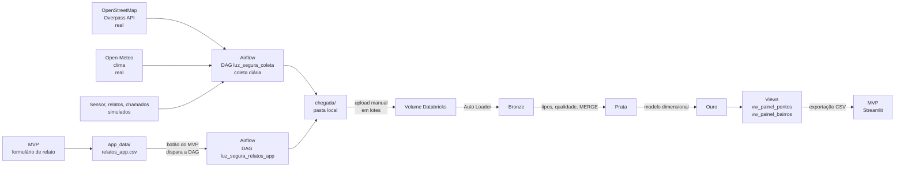

# Luz Segura | Big Data Architecture & Data Integration

Global Solution | 4ESPY

Pipeline de dados do **Luz Segura**, o componente **Dados** do MVP: coleta orquestrada no Airflow, ingestão incremental no Databricks (Bronze, Prata e Ouro), regras de qualidade, modelo dimensional, proteção de dados pessoais (LGPD) e entrega ao MVP, que mostra ao cidadão as paradas de ônibus com iluminação crítica perto dele.

## Contexto

Quem depende de transporte público e anda a pé ao anoitecer sabe como é esperar em um ponto de ônibus escuro. A iluminação precária aumenta o risco de assaltos e acidentes e afeta principalmente trabalhadores de turno, estudantes noturnos e idosos. Para piorar, o poder público só descobre o problema quando alguém reclama, e a reclamação costuma chegar mal localizada, repetida ou sem prioridade.

O **Luz Segura** é uma CitizenTech que cruza paradas de ônibus reais de Osasco (SP), medições de luminosidade, relatos de cidadãos e o andamento dos chamados de manutenção, para mostrar quais pontos estão mais escuros e quais bairros precisam de atenção primeiro. O cidadão consulta os pontos críticos perto dele e também pode relatar a iluminação de uma parada.

Este repositório contém o componente de **Dados** do projeto: o pipeline que coleta, trata e entrega as informações ao MVP. As paradas (OpenStreetMap) e o clima (Open-Meteo) são dados reais, e a iluminação, os relatos e os chamados são **simulados**, com a geração documentada em [`docs/simulacao.md`](docs/simulacao.md).

## Integrantes

- Fabrício Gutierrez Saavedra - RM97631
- Márcio Gastaldi - RM98811
- Arthur Bessa Pian - RM99215
- Davi Almeida Desenzi - RM550849
- João Victor Soares Rodrigues - RM551410

## Perguntas que o MVP responde

1. Quais pontos de ônibus perto de mim estão escuros?
2. Quais bairros precisam de atenção primeiro?
3. O relato enviado por cidadãos bate com a medição do sensor?
4. Quantos chamados de manutenção foram resolvidos e quanto tempo os pendentes esperam?

## Arquitetura e fluxo de dados



O Databricks Free Edition não se conecta ao Airflow. Por isso os arquivos gerados em `chegada/` são enviados ao Volume pela interface do Databricks, em lotes, e as views da Ouro são exportadas como CSV para o MVP.

## Fontes de dados

| Fonte | Tipo | Formato | Frequência | Observação |
|---|---|---|---|---|
| Paradas de ônibus (OpenStreetMap, Overpass API) | **Real**, externa | JSON achatado em CSV | Diária (snapshot) | Paradas dentro de 2 km de cada local de referência. A Overpass devolve o estado atual do mapa, então os arquivos de dias diferentes têm o mesmo conteúdo. 206 paradas distintas |
| Clima (Open-Meteo, API `archive`) | **Real**, externa | JSON | Diária | `cloud_cover` e `precipitation` por hora. Não exige chave |
| Leituras do sensor de luminosidade | **Simulada** | CSV | Diária | Valor bruto do conversor analógico (ADC, 0 a 4095), 1 leitura por hora (18h às 23h) por parada |
| Relatos de iluminação | **Simulada** + app | CSV | Diária + sob demanda | 33 linhas por dia nos simulados (com nome e contato fictícios). Os relatos do formulário do MVP têm `origem = app` e nenhum dado pessoal |
| Chamados de manutenção | **Simulada** | CSV | Diária | Foto diária dos chamados, com datas de abertura e de conserto |
| Bairros de referência | Referência estática | CSV | Única | Um ponto central por bairro, usado para atribuir o bairro de cada parada |

## Dados reais e simulados

Não existe uma base aberta de iluminação pública por parada de ônibus em Osasco, e a equipe não tem sensores instalados nas paradas. Por isso, três fontes foram **simuladas**, com a geração justificada e documentada, como o briefing da Global Solution permite.

| Dado | Origem | Observação |
|---|---|---|
| Paradas de ônibus (id, nome, coordenadas) | **Real**, OpenStreetMap (Overpass API) | 206 paradas distintas em um raio de 2 km de três locais de referência. © colaboradores do OpenStreetMap (licença ODbL) |
| Clima (nebulosidade e chuva por hora) | **Real**, Open-Meteo (API `archive`) | Sem chave de API |
| Iluminação das paradas (valor do sensor) | **Simulada** | Não representa a iluminação real de nenhuma parada |
| Relatos de cidadãos | **Simulada**, mais os enviados pelo formulário do MVP | Nomes e contatos dos simulados são fictícios |
| Chamados de manutenção | **Simulada** | Não representam chamados reais da prefeitura |
| Bairro de cada parada | **Derivado** | Referência mais próxima (aproximação) |

Os registros simulados têm `origem = 'simulado'`, e os do formulário do MVP têm `origem = 'app'`.

**Principais premissas da simulação:**
- O perfil de iluminação de cada parada é sorteado **uma única vez** (20% escuro, 30% fraco, 50% iluminado), com semente fixa, então a criticidade é estável entre os dias e reproduzível.
- `lux_estimado` = `valor_adc` × 0,008. **O fator é fictício**, não uma calibração de sensor.
- 15% dos relatos simulados recebem uma classe aleatória, para não haver concordância perfeita entre relato e sensor.
- Cada dia de arquivo traz **defeitos injetados de propósito** (sensor: 1 leitura nula e 1 fora da faixa; relatos: 1 duplicado, 1 com classe inválida e 1 em parada inexistente), para as regras de qualidade da Prata terem o que barrar.

**O que os resultados mostram e o que não mostram:** eles demonstram que o pipeline coleta, trata, valida, modela e entrega dados ao MVP, e que lotes novos entram sem duplicar. Não mostram a situação real da iluminação de Osasco: a concordância entre relato e sensor existe em boa parte por construção, e os relatos são sorteados sem relação com o clima, então qualquer diferença entre "com chuva" e "sem chuva" é acaso.

Detalhes da geração, dos defeitos injetados e das premissas de classificação em [`docs/simulacao.md`](docs/simulacao.md).

## Estrutura do repositório

```
├── README.md
├── docker-compose.yaml            # Airflow (quick-start oficial) com chegada/ e app_data/ montadas
├── dags/
│   ├── luz_segura_coleta.py       # DAG diária de coleta
│   ├── luz_segura_relatos_app.py  # DAG manual que exporta os relatos do formulário
│   └── geradores/
│       ├── osm.py                 # coleta das paradas (Overpass)
│       ├── simulacao.py           # sensor, relatos e chamados simulados
│       └── app_relatos.py         # exportação dos relatos do app
├── referencia/
│   └── bairros_referencia.csv
├── databricks/                    # notebooks (ordem de execução)
│   ├── 00_preparacao.py
│   ├── 01_bronze.py
│   ├── 02_prata.py
│   ├── 03_ouro.py
│   ├── 04_consultas.sql           # as 5 consultas (+1 opcional)
│   ├── 05_evidencias.sql
│   └── 06_consulta_relato_app.sql # rastreia um relato do app da Bronze à Ouro
├── mvp/
│   ├── app.py                     # MVP em Streamlit
│   ├── gerar_dados_demo.py        # dados de teste locais (os definitivos vêm da Ouro)
│   ├── requirements.txt
│   └── dados/                     # CSVs exportados das views da Ouro
├── amostras/                      # um pouco de cada fonte
├── docs/
│   └── simulacao.md
└── prints/                        # evidências do relatório
```

`chegada/` (saída do DAG), `app_data/` (relatos do formulário), `logs/` e `.env` ficam fora do Git.

## Como reproduzir

### Pré-requisitos
Docker Desktop (4 GB de memória para o Docker, de preferência 8 GB), conta no Databricks Free Edition, Python 3.10+ e Git.

### 1. Airflow
1. Baixe o `docker-compose.yaml` da documentação oficial do Airflow ("Running Airflow in Docker"). Este projeto usou a versão 3.1.2.
2. Adicione ao `docker-compose.yaml`, junto aos demais volumes:
   ```yaml
   - ${AIRFLOW_PROJ_DIR:-.}/chegada:/opt/airflow/chegada
   - ${AIRFLOW_PROJ_DIR:-.}/app_data:/opt/airflow/app_data
   ```
3. Crie as pastas `dags`, `logs`, `plugins`, `config`, `chegada` e `app_data`, e o arquivo `.env` com `AIRFLOW_UID=50000`.
4. Inicialize e suba:
   ```bash
   docker compose up airflow-init
   docker compose up
   ```
5. Acesse `http://localhost:8080` com o usuário e a senha configurados no seu Airflow local e **ative as duas DAGs**.

**`luz_segura_coleta`** (diária, `catchup` desde 03/11/2026): `inicio`, depois `coletar_pontos_osm`, depois **4 tarefas em paralelo** (`coletar_clima`, `gerar_sensor`, `gerar_relatos`, `gerar_chamados`) e, por fim, `conferir_chegada`, que falha se faltar algum arquivo do dia. Cada tarefa tem 2 tentativas automáticas. Nenhuma fonte usa chave de API, então não há segredo no código.

**`luz_segura_relatos_app`** (sem agendamento): exporta para `chegada/relatos/` somente os relatos do formulário ainda não exportados (controle por `id_relato`).

### 2. Databricks
1. Importe os notebooks de `databricks/` e execute o `00_preparacao` (cria o schema `luz_segura`, o volume `chegada` e as pastas).
2. Suba `referencia/bairros_referencia.csv` para a pasta `referencia/` do volume.
3. Suba os arquivos de `chegada/` para as pastas do volume **em lotes**. Após cada lote, execute o `01_bronze` registrando o momento na última célula (`1_lote1`, `2_lote2` e assim por diante).
4. Execute `02_prata` e `03_ouro`, depois `04_consultas` e `05_evidencias`.
5. Exporte `vw_painel_pontos` e `vw_painel_bairros` como CSV para `mvp/dados/`.

### 3. MVP
```bash
cd mvp
pip install -r requirements.txt
python gerar_dados_demo.py      # opcional: dados de teste, antes de exportar as views da Ouro
streamlit run app.py
```
Para o botão "Processar relatos agora", defina as variáveis de ambiente `AIRFLOW_USER` e `AIRFLOW_PASSWORD` (e, se o nome da DAG for diferente, `AIRFLOW_DAG_ID`) **no terminal, antes de abrir o app**. Nenhuma credencial fica no código.

## Camadas

### Bronze (dado bruto)
Carga incremental com **Auto Loader** (`cloudFiles`, `availableNow`) e checkpoint: só entram os arquivos novos, e rodar de novo não duplica. Cada linha guarda `arquivo_origem` e `carregado_em`.

Tabelas: `bronze_pontos_osm`, `bronze_clima`, `bronze_sensor`, `bronze_relatos`, `bronze_chamados` e `bronze_bairros_referencia`.

### Prata (dado tratado)
Tipos corretos, nulos e inválidos tratados e `MERGE` pela chave. Cada tabela tem **3 regras de qualidade**, e o total barrado por cada uma é exibido em uma tabela de contagem.

| Tabela | Chave do MERGE | Regras de qualidade |
|---|---|---|
| `prata_pontos` | id_local | id nulo; coordenada inválida; fora da área (mais de 2,1 km da referência mais próxima) |
| `prata_clima` | cidade + data_hora | nebulosidade fora de 0 a 100; chuva negativa; valor nulo |
| `prata_sensor` | id_leitura | leitura nula; fora de 0 a 4095; parada inexistente |
| `prata_relatos` | id_relato | classe inválida; parada inexistente; duplicado (mesmo ponto, contato e classe em menos de 15 min) |
| `prata_chamados` | id_chamado | id nulo; parada inexistente; conserto antes da abertura |

- O arquivo de paradas chega repetido todos os dias, e a Prata guarda uma linha por parada.
- O **bairro** de cada parada é o da referência mais próxima (aproximação).
- O clima chega como texto JSON com listas paralelas, convertido com `from_json` e expandido com `arrays_zip` e `explode`.
- Dos chamados, é mantida a foto mais recente de cada `id_chamado`.
- Nos relatos do app, o contato é vazio, então o critério de duplicado vira ponto + classe + janela de 15 min.

### Ouro (modelo dimensional)

| Tabela | Tipo | Conteúdo |
|---|---|---|
| `fato_ocorrencia` | Fato | Um registro por relato ou medição (`tipo_evento`), com classe, lux estimado, `relator_hash` e `origem_dado` |
| `fato_chamado` | Fato | Um registro por chamado, com status, dias para conserto e dias pendente |
| `dim_local` | Dimensão | Parada, nome (quando o OSM informa), bairro, coordenadas, tipo e município |
| `dim_tempo` | Dimensão | Data, hora, faixa horária e dia da semana |
| `dim_clima` | Dimensão | Nebulosidade, chuva e condição de chuva |

**Views que o MVP consome:** `vw_painel_pontos` (por parada: lux médio, relatos, situação, se é crítico e o status do chamado) e `vw_painel_bairros` (por bairro: pontos, críticos, % críticos, lux médio, pior ponto, chamados, resolvidos e maior pendência).

**Critérios (premissas da simulação):** Escuro é lux médio abaixo de 1,5, Fraco é abaixo de 5, e **ponto crítico** é lux médio abaixo de 1,5 com pelo menos um relato "escuro".

## Consultas SQL (`databricks/04_consultas.sql`)

| # | Pergunta | Tipo |
|---|---|---|
| 1 | Quais são as paradas mais escuras? | Operacional |
| 2 | Resumo por bairro: pontos críticos, lux médio e pior ponto | Gestão |
| 3 | Em que faixa horária cada bairro concentra relatos "escuro"? | Padrão temporal |
| 4 | Efeito do clima (com chuva e sem chuva) nos relatos | Cruzamento com fonte real |
| 5 | Chamados resolvidos por bairro e pendência máxima | **Impacto** |

As interpretações dos resultados estão no relatório em PDF.

## Resultados da execução

### Lotes de ingestão (Bronze, requisito 05)

| Momento | Pontos | Clima | Sensor | Relatos | Chamados |
|---|---|---|---|---|---|
| 1_lote1 | 206 | 1 | 1.236 | 33 | 39 |
| 2_lote2 | 412 | 2 | 2.472 | 66 | 78 |
| 3_lote3 | 824 | 4 | 4.944 | 132 | 156 |
| 4_reexecucao (sem arquivo novo) | 824 | 4 | 4.944 | 132 | 156 |
| 5_relatos_app (1 relato do formulário) | 824 | 4 | 4.944 | **133** | 156 |

Foram carregados 4 dias de coleta, em 3 lotes de 1, 1 e 2 dias (arquivos de [PREENCHER: datas]). A reexecução manteve as contagens, e o relato do app foi o único acréscimo.

### Qualidade (Prata)

| Tabela | Lidos | Barrados | Detalhe |
|---|---|---|---|
| `prata_pontos` | 206 (de 824 linhas na Bronze) | 0 | Uma linha por parada |
| `prata_clima` | 96 | 0 | 4 dias × 24 horas |
| `prata_sensor` | 4.944 | 8 | 4 leituras nulas e 4 fora da faixa |
| `prata_relatos` | 133 (132 antes do relato do app) | 12 | 4 classes inválidas, 4 paradas inexistentes e 4 duplicados |
| `prata_chamados` | 39 | 0 | Foto mais recente de cada chamado |

Os barrados são os defeitos **injetados de propósito** na simulação (ver `docs/simulacao.md`). O relato do formulário passou em todas as regras.

### Painel por bairro (`vw_painel_bairros`)

| Bairro | Pontos | Críticos | % críticos | Lux médio | Pior ponto (lux) | Chamados |
|---|---|---|---|---|---|---|
| Mutinga | 63 | 9 | 14 | 6,3 | 0,77 | 14 |
| Vila Campesina | 56 | 7 | 13 | 8,3 | 0,77 | 11 |
| Centro | 19 | 1 | 5 | 6,5 | 0,78 | 3 |
| Presidente Altino | 24 | 1 | 4 | 8,0 | 0,77 | 4 |
| Cidade de Deus | 44 | 1 | 2 | 7,7 | 0,77 | 7 |

Os valores dependem dos dados simulados e dos 4 dias carregados. Eles mostram o funcionamento do pipeline e não são uma medição real da iluminação de Osasco.

## Integração com o MVP

O MVP (`mvp/app.py`, Streamlit) lê os CSVs exportados das duas views da Ouro e tem três telas:

1. **Perto de você:** o usuário escolhe Casa, Trabalho ou Faculdade (ou usa a localização do navegador, opcional) e um raio de até 2 km. Vê o mapa, o número de pontos críticos, o crítico mais próximo e a tabela dos mais críticos.
2. **Panorama por bairro:** bairro prioritário, gráfico e tabela.
3. **Relatar problema:** formulário sem dado pessoal (ponto, classificação e data e hora). Um botão dispara a DAG `luz_segura_relatos_app`, que leva os relatos novos para `chegada/relatos/`.

**Caminho de um relato do formulário (testado):** formulário, `app_data/relatos_app.csv`, DAG `luz_segura_relatos_app`, `chegada/relatos/relatos_app_*.csv`, upload ao volume, Bronze (`bronze_relatos` passou de 132 para 133), Prata, Ouro. O rastreio por `id_relato` está em `databricks/06_consulta_relato_app.sql`.

Link do MVP: [PREENCHER]

## LGPD e proteção de dados

- **Minimização:** o formulário do MVP **não coleta** nome, contato nem localização. Grava só a parada, a classificação e a data e hora.
- **Hash na Ouro:** `relator_nome` e `relator_contato` dos relatos simulados **não passam para a Ouro**. Entra apenas `relator_hash`, calculado com `sha2(relator_contato, 256)`. Nos relatos do app o hash é nulo, porque não há contato.
- **Dados fictícios:** todos os nomes e contatos do repositório são inventados.
- **Posição do usuário:** a localização opcional do navegador é usada só na tela, em memória, e não é gravada.
- **Sem credenciais no código:** nenhuma fonte exige chave, e o acesso do botão ao Airflow usa variáveis de ambiente. `.env`, `chegada/` e `app_data/` estão no `.gitignore`.

## Limitações

- Três das cinco fontes são **simuladas** (sensor, relatos e chamados). Só as paradas (OpenStreetMap) e o clima (Open-Meteo) são reais, e a iluminação mostrada é simulada.
- A Overpass devolve o estado atual do mapa, então os arquivos diários de paradas são cópias entre si.
- O bairro é atribuído pela **referência mais próxima**, o que é uma aproximação, principalmente entre Cidade de Deus e Vila Campesina, que estão a cerca de 0,8 km.
- A ingestão no Databricks é **manual** (upload em lotes, por limitação do Free Edition), e o MVP lê um **snapshot** das views, então o painel não atualiza sozinho.
- O OpenStreetMap pode ter paradas não mapeadas ou sem nome, e muitas paradas aparecem sem nome.
- Os arquivos gerados pelo container do Airflow usam o fuso UTC no nome (por exemplo `relatos_app_20261116_222618.csv`), enquanto a interface do Airflow mostra o horário local.

## Links

- Vídeo do pitch: https://youtu.be/oAgjTRLe3cA